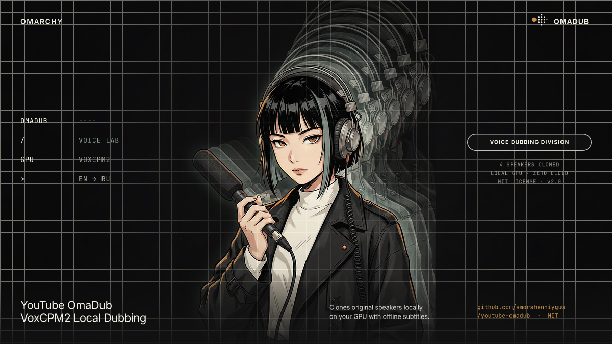

<p align="center">
  
</p>

<h1 align="center">YouTube OmaDub</h1>

<p align="center">
  <strong>Local multi-speaker AI dubbing &amp; clickable interactive subtitles for YouTube (and X.com).</strong><br />
  Voice cloning, speaker clustering, quality reranking, and 48 kHz mastering run 100% locally on your GPU —<br />
  while you choose any Cloud API, a Local LLM (Ollama / llama.cpp / LM Studio / vLLM), or Chrome's built-in offline translator for text.
</p>

<p align="center">
  <a href="LICENSE"></a>
  
  
  
  <a href="docs/README.ru.md"></a>
</p>

---

## Why YouTube OmaDub?

Most browser dubbing tools send your videos to paid cloud servers and replace every speaker with one robotic voice. **YouTube OmaDub** keeps the entire voice pipeline on your own machine:

- **Clones every speaker in the video (`VoxCPM2`)**: Extracts clean reference clips directly from the video, clusters speakers with Resemblyzer, and locks a fixed Russian anchor per speaker to prevent timbre drift.
- **Pluggable text translation & adaptation (3 modes, switchable live in Extension Options)**:
  - **Any OpenAI-compatible Cloud API** — OpenAI, OpenRouter, DeepSeek, Groq, Together, or your own HTTPS endpoint.
  - **Any Local LLM Server** — **Ollama**, **LM Studio**, **`llama.cpp` server**, or **vLLM** (no API key required, `<think>` / fenced-JSON tolerant, plus automatic Ollama VRAM unload before TTS starts).
  - **Chrome Built-in Translator Only** — 100% offline via Chrome 138+'s on-device Translator API with zero external LLM, zero API keys, and zero extra VRAM.
- **Progressive streaming playback**: Start watching as soon as the initial buffer is ready (or resume from any timestamp mid-video) while the rest of the video synthesizes in the background at up to **5× realtime**.
- **Portable zero-loss GPU acceleration**:
  - Automatic GPU profiler (`detect_gpu_profile`) adapts `dtype`, `CUDA Graphs`, and super-batch size (`B=2 / 4 / 6 / 8`) to your GPU architecture and VRAM.
  - Zero-VRAM-cost optimizations (`QKV` & `MLP` weight fusion, fused `RMSNorm`, bounded `StaticKVCache`, split-SDPA, `AudioVAE` `weight_norm` folding) work on every CUDA GPU.
  - Full idle VRAM release (`CUDAGraph.reset()` + `empty_cache()`) once dubbing finishes.
- **CPU-only Lean Cascade reranker** (0 extra GPU VRAM): GigaAM v3 Russian CTC + WeSpeaker ResNet34 + acoustic timing/F0 scoring picks the cleanest take per phrase.
- **Clickable word-by-word subtitles**: Works on YouTube and X.com with instant click/drag translation, dual-subtitle mode, and one-click phrase replay.
- **Privacy & security by design**: Strictly loopback-only (`127.0.0.1:8773`), per-install random auth token (`X-VoxDub-Token`), `0600` config files, API keys masked and never returned over HTTP.

---

## Hardware & GPU Auto-Profile

| GPU Class | Architecture | Default Dtype | CUDA Graphs | Super-Batch (`B`) | Notes |
|---|---|---|---|---|---|
| **16 GB+ modern** (RTX 5070 Ti / 5080 / 4080 / 4070 Ti S / 3090 / 4090 / 5090) | Ampere / Ada / Hopper / Blackwell (`SM >= 8.0`) | `BF16` (+ FP32 VAE) | **Auto ON** | **`B=8`** (4 segs × 2 takes) | Fastest (~4.5–5.3× realtime) |
| **12 GB modern** (RTX 4070 / 4070 S / 5070 / 3060 12G) | `SM >= 8.0` | `BF16` (+ FP32 VAE) | **Auto ON** | **`B=4–6`** | Smooth streaming |
| **8 GB modern** (RTX 3070 / 4060 / 4060 Ti 8G) | `SM >= 8.0` | `BF16` (+ FP32 VAE) | Off (safe) | **`B=2`** | Tight VRAM safe mode |
| **Older CUDA** (RTX 20-series) | Turing (`SM 7.5`) | `FP16` (+ FP32 VAE) | Off | **`B=2`** | Weight fusion + fast KV active |

Override any parameter via environment variables:
- `VOXDUB_CUDA_GRAPHS=auto|1|0`
- `VOXDUB_MAX_BATCH=auto|2|4|6|8`
- `VOXDUB_DTYPE=auto|bf16|fp16`
- `VOXDUB_MODEL_DIR=/path/to/VoxCPM2`

---

## Quick Start

### Prerequisites
- Linux (or WSL2) with an NVIDIA GPU (8 GB+ VRAM; 12–16 GB+ recommended)
- Python 3.11+
- `ffmpeg` and `yt-dlp` on `PATH`
- Google Chrome / Chromium 138+ (for built-in on-device Translator API)

### 1. Clone & set up the local backend

```bash
git clone https://github.com/smorshenniygus/youtube-omadub.git
cd youtube-omadub/backend

python3 -m venv .venv
source .venv/bin/activate

# Install PyTorch matching your CUDA version first (example for CUDA 12.8):
pip install torch torchaudio --index-url https://download.pytorch.org/whl/cu128

# Install backend dependencies
pip install -r requirements.txt

# Download VoxCPM2 + optional CPU reranker weights (GigaAM v3 + WeSpeaker)
python scripts/download_models.py

# Start the local service (binds strictly to 127.0.0.1:8773)
python dubbing_service.py --port 8773
```

On first start, the daemon generates a random auth token at `backend/data/token`.

### 2. Load the Chrome extension

1. Open `chrome://extensions` and enable **Developer mode**.
2. Click **Load unpacked** and select the `extension/` directory.
3. Open **Extension Options**:
   - Paste the token from `backend/data/token` and click **Save & Connect** (your detected GPU profile appears automatically).
   - Pick your **Text Translation & Adaptation Provider**:
     - **Cloud / Custom API** (OpenAI, OpenRouter, DeepSeek, Groq, or any OpenAI-compatible URL)
     - **Local LLM** (Ollama, LM Studio, `llama.cpp`, vLLM — click **Test Connection** to auto-discover installed models)
     - **Chrome Built-in Only** (zero external LLM, 100% offline)
   - Click **Save Provider Settings**.

See [docs/PROVIDERS.md](docs/PROVIDERS.md) for complete setup recipes (including Ollama VRAM handoff).

### 3. Optional: run as a systemd user service

```bash
mkdir -p ~/.config/systemd/user
cp backend/scripts/voxdub.service.example ~/.config/systemd/user/voxdub.service
# Adjust WorkingDirectory / ExecStart if you cloned outside ~/youtube-omadub
systemctl --user daemon-reload
systemctl --user enable --now voxdub.service
```

---

## Development & Tests

```bash
# Backend tests (Python)
cd backend
.venv/bin/python -m unittest discover -s tests

# Extension tests (Node.js 20+)
cd extension
node --test tests/*.test.cjs
```

Safe disk retention (dry-run by default):
```bash
cd backend
.venv/bin/python scripts/prune_data.py          # report reclaimable cache
.venv/bin/python scripts/prune_data.py --apply  # delete stale cache
```

---

## Documentation

- [docs/PROVIDERS.md](docs/PROVIDERS.md) — Configuring Cloud APIs, Ollama, LM Studio, `llama.cpp`, vLLM, or Chrome-only mode
- [docs/ARCHITECTURE.md](docs/ARCHITECTURE.md) — Pipeline architecture, GPU auto-profile, VRAM coordination, and security model
- [docs/README.ru.md](docs/README.ru.md) — Руководство на русском языке

## License

MIT — see [LICENSE](LICENSE).
