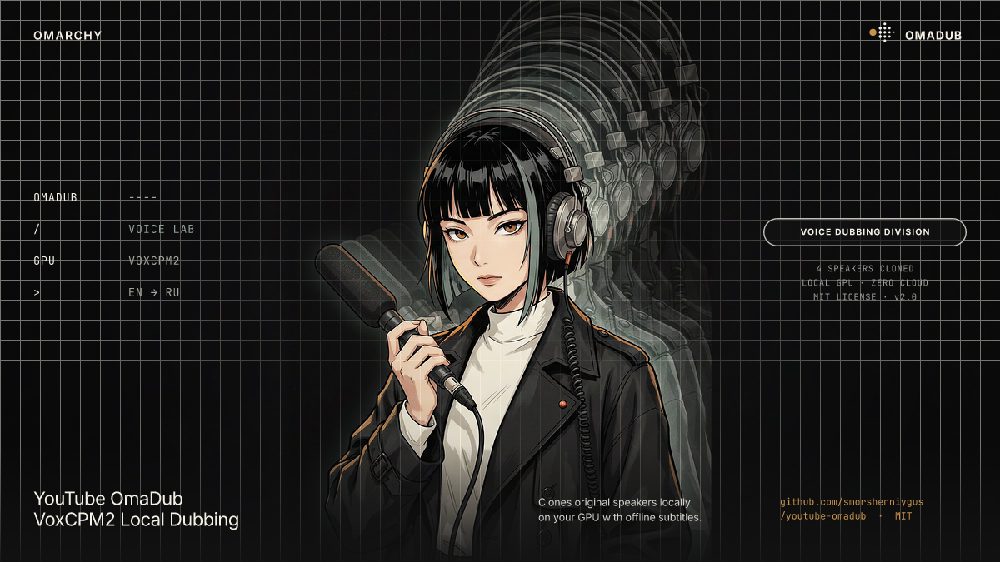

<p align="center">
  
</p>

# YouTube OmaDub — руководство на русском

**Локальная многоголосая AI-озвучка и кликабельные субтитры для YouTube (и X.com).**

Вся тяжёлая часть — клонирование голосов спикеров (**VoxCPM2**), диаризация, оценка качества дублей (GigaAM v3 + WeSpeaker), мастеринг 48 кГц и синхронизация с видео — крутится **полностью локально на вашем компьютере**.

Для перевода и адаптации текста под тайминги вы свободно выбираете один из **3 режимов** прямо в настройках расширения Chrome:

1. **Любой OpenAI-совместимый API** — OpenAI, OpenRouter, DeepSeek, Groq, Together или ваш собственный эндпоинт.
2. **Локальная LLM** — **Ollama**, **LM Studio**, **llama.cpp server** или **vLLM** (без API-ключа; для Ollama есть авто-выгрузка модели из VRAM перед запуском синтеза VoxCPM2, чтобы 8–16 ГБ видеокарты не упирались в память).
3. **Только встроенный переводчик Chrome** — 100% офлайн без внешних LLM, без ключей и без дополнительного расхода VRAM.

---

## Авто-профиль GPU

При запуске сервис автоматически определяет архитектуру и объём видеопамяти вашей карты:

| Видеокарта | Архитектура | Dtype | CUDA Graphs | Батчинг (`B`) |
|---|---|---|---|---|
| **16 ГБ+ современные** (RTX 5070 Ti / 5080 / 4080 / 4070 Ti Super / 3090 / 4090 / 5090) | Ampere / Ada / Hopper / Blackwell (`SM >= 8.0`) | `BF16` (+ FP32 VAE) | **Авто ВКЛ** | **`B=8`** (4 сегмента × 2 дубля) |
| **12 ГБ современные** (RTX 4070 / 4070 Super / 5070 / 3060 12G) | `SM >= 8.0` | `BF16` (+ FP32 VAE) | **Авто ВКЛ** | **`B=4–6`** |
| **8 ГБ современные** (RTX 3070 / 4060 / 4060 Ti 8G) | `SM >= 8.0` | `BF16` (+ FP32 VAE) | Выкл | **`B=2`** |
| **Старые CUDA-карты** (RTX 20-серия) | Turing (`SM 7.5`) | `FP16` (+ FP32 VAE) | Выкл | **`B=2`** |

Универсальные zero-loss оптимизации (слияние весов QKV/MLP, fused RMSNorm, bounded StaticKVCache, split-SDPA, weight_norm folding AudioVAE) не требуют лишней VRAM и работают на всех видеокартах CUDA.

Переопределение через переменные окружения:
- `VOXDUB_CUDA_GRAPHS=auto|1|0`
- `VOXDUB_MAX_BATCH=auto|2|4|6|8`
- `VOXDUB_DTYPE=auto|bf16|fp16`

---

## Быстрый старт

### 1. Клонирование и запуск бэкенда

```bash
git clone https://github.com/smorshenniygus/youtube-omadub.git
cd youtube-omadub/backend

python3 -m venv .venv
source .venv/bin/activate

# Установите PyTorch под вашу версию CUDA (пример для CUDA 12.8):
pip install torch torchaudio --index-url https://download.pytorch.org/whl/cu128

# Зависимости бэкенда
pip install -r requirements.txt

# Скачивание весов VoxCPM2 и CPU-реранкера (GigaAM v3 + WeSpeaker)
python scripts/download_models.py

# Запуск локального сервиса (слушает только 127.0.0.1:8773)
python dubbing_service.py --port 8773
```

При первом запуске создаётся случайный токен авторизации в `backend/data/token`.

### 2. Установка расширения Chrome

1. Откройте `chrome://extensions`, включите **Режим разработчика** (*Developer mode*).
2. Нажмите **Загрузить распакованное расширение** (*Load unpacked*) и выберите папку `extension/`.
3. Откройте **Настройки** расширения:
   - Вставьте токен из `backend/data/token` и нажмите **Save & Connect** — ниже отобразится ваш авто-профиль GPU.
   - Выберите режим перевода/адаптации текста (**Cloud / Custom API**, **Local LLM** или **Chrome Built-in Only**).
   - Нажмите **Test Connection**, затем **Save Provider Settings**.

Подробные примеры для Ollama, `llama.cpp`, LM Studio, OpenRouter, DeepSeek и OpenAI — в [PROVIDERS.md](PROVIDERS.md).
